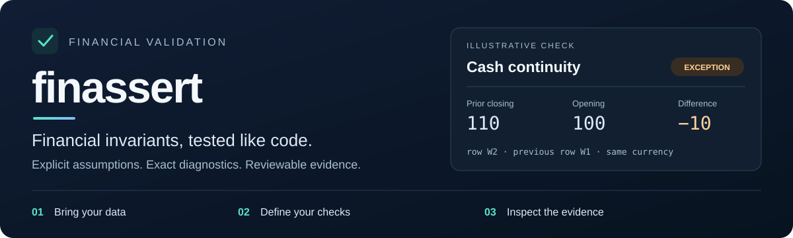

<div align="center">

# finassert

**Financial invariants, tested like code.**

Deterministic checks for the financial relationships your data must satisfy.

[](https://www.python.org/)
[](LICENSE)
[](CHANGELOG.md)

**[Get started](#quick-start)** · **[Choose a workflow](#choose-your-workflow)** · **[Explore checks](#explore-the-checks)** · **[Treasury walkthrough](#try-a-13-week-cash-forecast)**

</div>



A file can have the right columns and still contain the wrong numbers.
finassert checks relationships such as **weights adding to 100%**, **cash
reconciling**, **positions rolling forward**, and **forecast weeks connecting**.
Each result explains what was checked, what was observed, and where it broke.

| Finance-native | Reproducible | Fits your workflow |
| :--- | :--- | :--- |
| Explicit equations, signs, groups, and assumptions. | Decimal-aware tolerances and stable rule identifiers. | Python, YAML policies, CLI, browser, and assistant tools. |
| No inferred FX or institutional limits. | Inspectable JSON and readable HTML reports. | No pandas, NumPy, or database dependency in the core. |

> **Project status:** pre-alpha, under active development. APIs may change before
> 1.0. Install from a checkout or an exact source revision; no published PyPI
> release or hosted documentation is claimed.

## Choose your workflow

| You want to… | Start here | What you get |
| :--- | :--- | :--- |
| **Check a file without writing code** | [Browser guide](docs/browser-app.md) | File preview, check settings, downloadable reports and policies. |
| **Validate data in Python** | [Quick start](#quick-start) | Composable rules for mappings, row records, or pandas DataFrames. |
| **Gate a pipeline or scheduled job** | [CLI and policies](docs/command-line.md) | Versioned policies, JSON artifacts, and distinct exit codes. |
| **Review a treasury forecast** | [13-week walkthrough](#try-a-13-week-cash-forecast) | Schedule coverage and cash continuity by series and currency. |
| **Use an AI assistant** | [Assistant tool server](docs/assistant.md) | The same checks through MCP, within folders you allow. |
| **Work inside Excel** | [Excel add-in](docs/excel-add-in.md) | An initial task pane; real-Excel verification remains outstanding. |

## Quick start

### 1. Install from the repository

Requires **Python 3.11+** and [uv](https://docs.astral.sh/uv/).

```bash
git clone https://github.com/thatquantguy44/finassert.git
cd finassert
uv sync --all-extras --dev
```

This installs the checkout with optional interfaces and development tools.

<details>
<summary><strong>Install only what your application needs</strong></summary>

From a local checkout, use an editable core install:

```bash
python -m pip install -e .
```

| Extra | Adds |
| :--- | :--- |
| `pandas` | pandas DataFrame support |
| `cli` | YAML policies for the command line |
| `parquet` | Parquet input through pyarrow |
| `assistant` | The MCP assistant tool server |

For example, `python -m pip install -e ".[cli,pandas]"`.
CSV, JSON, and Excel `.xlsx` readers need no extra parser dependency.
For reproducible deployments, pin an exact source commit or verified built
artifact rather than following a floating branch.

</details>

### 2. Run your first check

Save this as `quickstart.py` and run `uv run python quickstart.py`:

```python
import finassert as fa

portfolio = {
    "weight": [0.40, 0.35, 0.25],
    "market_value": [4_000_000, 3_500_000, 2_500_000],
}

report = fa.check(
    portfolio,
    rules=[
        fa.weights_sum_to_one(column="weight", tolerance=1e-8),
        fa.non_negative(column="market_value"),
    ],
)
print(report.summary())
```

```text
finassert PASS: 2 passed, 0 failed, 0 errors, 0 skipped
```

<details>
<summary><strong>See a failed check and inspect its evidence</strong></summary>

```python
import finassert as fa

report = fa.check({"weight": [0.40, 0.50]}, [fa.weights_sum_to_one()])
result = report.results[0]

print(result.rule_id)  # portfolio.weights_sum_to_one
print(result.observed)  # 0.9
print(result.expected)  # 1
print(result.outcome)  # failed
```

Results retain rule identity, outcome, severity, observed and expected values,
tolerance, and diagnostic metadata. Use `report.to_dict()` for a JSON-compatible
representation. Decimal amounts serialize as strings.

</details>

### 3. Create a report you can share

```bash
uv run finassert check \
  --config examples/policy.yml \
  --input examples/positions.csv \
  --output report.json \
  --html report.html
```

Open `report.html`. **This sample intentionally fails one check** on a negative
market value and exits with code `1`; that is the expected result. The HTML
explains the exception and the JSON contains the corresponding report artifact.

## Prefer a visual workflow?

Build the browser app from your checkout:

```bash
uv run python scripts/build_web.py
```

Open **`dist/web/finassert.html`**, then:

1. **Choose your data** — preview a CSV, JSON file, or Excel workbook.
2. **Choose your checks** — open a policy, start from a template, or add checks.
3. **Review the results** — download HTML, JSON, and the exact policy that ran.

Validation runs in your browser; your dataset is not uploaded. At startup,
the app downloads its pinned Python runtime and YAML reader from a CDN. After
startup it makes no network requests. See the [browser guide](docs/browser-app.md)
for privacy details and self-hosting options.

<details>
<summary><strong>Write a policy instead of Python</strong></summary>

```yaml
version: 1
name: Long-only positions
assumptions:
  - Weights are fractions of 1, not percentages.
  - Market values must be nonnegative for this long-only file.
rules:
  - rule: weights_sum_to_one
    column: weight
    tolerance: "0.0001"
  - rule: non_negative
    column: market_value
```

Column names must match your file. Quote tolerances to preserve exact decimal
intent. Unknown settings and invalid policies are reported, never silently
corrected.

```bash
uv run finassert rules
uv run finassert templates
uv run finassert init --template long-only-holdings --output policy.yml
```

[Read the policy guide →](docs/command-line.md)

</details>

## Try a 13-week cash forecast

Check **208 synthetic rows across 16 independent series**: two entities,
currencies, scenarios, and forecast vintages, each with thirteen weekly periods.

```bash
uv run finassert check \
  --config examples/treasury/policy.yml \
  --input examples/treasury/cash-forecast.csv \
  --html treasury-report.html
```

| Check | The question it answers |
| :--- | :--- |
| `treasury.forecast_coverage` | Does every expected series contain exactly one row for every week? |
| `treasury.cash_continuity` | Does each week's opening cash match the prior week's closing cash? |

The sample passes both checks. Scope is declared independently of the data, so
an entirely absent entity or currency is detected. Cash continuity refuses to
bridge a missing or duplicate week. Currencies stay separate.

<details>
<summary><strong>Explore failure cases and what comes next</strong></summary>

The [fixture guide](examples/treasury/README.md) and
[failure recipes](examples/treasury/failure-cases.json) cover missing weeks,
missing series, duplicate weeks, and disconnected cash balances. Each recipe
identifies the rows to change and the expected outcome.

These checks validate the supplied schedule. They do not establish forecast
accuracy or liquidity sufficiency. Compose the existing
[`cash_reconciles` rule](docs/examples/cash-reconciliation.md) for the
within-week cash-flow identity.

**Planned next:** minimum cash buffers and facility capacity, followed by
forecast-versus-actual checks and financing schedules. QuantMeridian integration
is designed but remains deferred.

[Treasury guide →](docs/examples/treasury-forecast.md) ·
[Specification and plan →](specs/0012-treasury-capital-markets/SPEC.md)

</details>

## Explore the checks

| Workflow | Available checks | Walkthrough |
| :--- | :--- | :--- |
| **Portfolio integrity** | Weight totals, required fields, duplicates, nonnegative values | [Portfolio validation](docs/examples/portfolio-validation.md) |
| **Accounting** | Cash and NAV reconciliation with explicit grouping and signs | [Cash](docs/examples/cash-reconciliation.md) · [NAV](docs/examples/nav-reconciliation.md) |
| **Valuation and returns** | Quantity × price × multiplier, simple return reconciliation | [Valuation and returns](docs/examples/valuation-and-returns.md) |
| **Exposure and limits** | Gross, net, position, and numeric-range checks | [Exposure limits](docs/examples/exposure-limits.md) |
| **Rebalancing** | Weights versus market values, target drift, turnover | [Rebalancing](docs/examples/rebalancing.md) |
| **Position lifecycle** | Opening quantity, buys, sells, adjustments, and closing quantity | [Position roll-forward](docs/examples/position-rollforward.md) |
| **Treasury schedules** | Expected weekly coverage and cash continuity | [Treasury forecasts](docs/examples/treasury-forecast.md) |

**Inputs:** mappings, row records, and optional pandas DataFrames; files in CSV,
JSON, Excel `.xlsx`/`.xlsm`, and optional Parquet. The browser supports CSV, JSON,
and Excel; Parquet requires the CLI.

**Outputs:** text summaries, JSON artifacts, and self-contained HTML reports.
Rules do not normalize or mutate your input data.

## Understand the result

| Outcome | Meaning |
| :--- | :--- |
| **Passed** | The configured relationship holds for the evaluated data. |
| **Failed** | A check found a violation; severity determines whether it blocks the report. |
| **Error** | A check could not run, for example because a configured column is missing. Always blocks. |
| **Skipped** | A check was not evaluated under its explicit skip policy. |

An empty rule set or skipped checks can produce a passing core report. If a
workflow requires particular checks, enforce their coverage before treating a
dataset as validated. Warning and info failures remain visible even when they
do not block the default report. Use `--fail-on warning` for a stricter CLI gate.

Negative weights and balances can be legitimate. Apply nonnegative rules only
where financial meaning requires it. Null handling is explicit and rule-specific;
the default is failure. Limits, FX conversion, and sign conventions are explicit.

<details>
<summary><strong>CLI exit codes for automation</strong></summary>

| Code | Meaning |
| :--- | :--- |
| `0` | No blocking result at the configured threshold; may include skips or warnings. |
| `1` | At least one financial check failed at the blocking threshold. |
| `2` | At least one check could not run; takes precedence over `1`. |
| `3` | Invalid command, invalid policy, or unreadable policy. |
| `4` | Unreadable input or an output report could not be written. |

Use `raise_on_error=True` in Python to raise `RuleEvaluationError` immediately
instead of recording an evaluation error and continuing.

</details>

## Build on finassert

The dependency-free engine runs `Rule` objects in caller-provided order. Each
returns a `ValidationResult`; the engine aggregates a `ValidationReport`.
Optional dataframe and interface dependencies stay outside the core import path.

| Reference | Use it to… |
| :--- | :--- |
| [API reference](docs/reference/index.md) | Find factories, contracts, tolerances, and report types. |
| [Architecture](docs/architecture.md) | Understand the engine and adapter boundaries. |
| [Rule development](docs/rule-development.md) | Add a check with explicit financial semantics. |
| [Specifications](specs/README.md) | Review implemented and proposed contracts. |
| [Roadmap](docs/roadmap.md) | Follow adapter, financing, units, and interface work. |

<details>
<summary><strong>Contributor checks</strong></summary>

```bash
uv run pytest
uv run ruff check .
uv run ruff format --check .
uv run mypy src/finassert
uv run mkdocs build --strict
uv build
uv run python scripts/verify_dist.py dist
```

Read [CONTRIBUTING.md](CONTRIBUTING.md) before substantial changes. It covers
financial-semantics proposals, synthetic test data, and commit identity rules.
Security reports follow [SECURITY.md](SECURITY.md).

</details>

---

<div align="center">

**Bring your data. Define your checks. Inspect the evidence.**

[Getting started](docs/getting-started.md) · [Report an issue](https://github.com/thatquantguy44/finassert/issues) · [MIT License](LICENSE) · [Back to top](#finassert)

</div>
